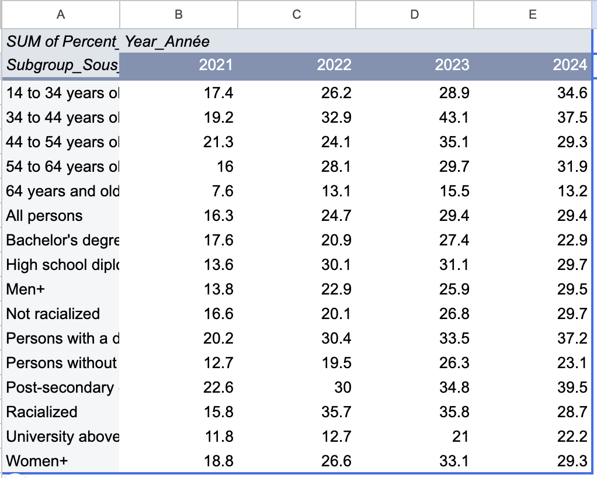
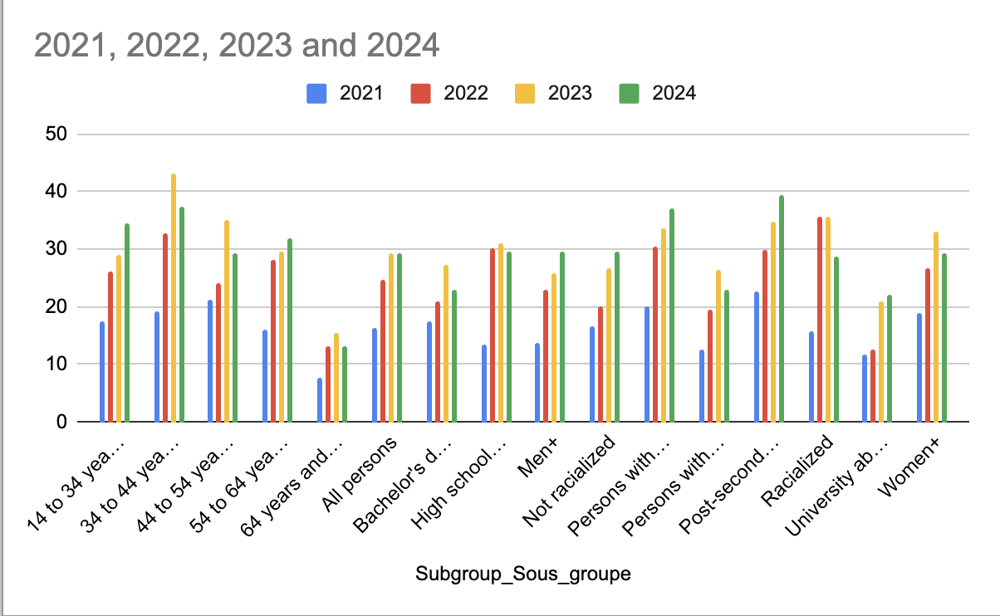

**Date** 
**Course Code & Course Name** 
**Student's First Name & Last Name** 
**Presented to Jean-Sébastien Marier** 

# Deliverable 2: Exploratory Data Analysis (EDA)
# 1. Getting Data

## Short Brief
For this data on financial security, I decided to do a quick analysis of the percentage of people who live in Ottawa-Gatineau. I wanted to see what percentage of those people answered (1) “very easy or easy” to the question, “In the past 12 months—how difficult or easy was it for your household to meet its financial needs in terms of transportation—housing- food- clothing and other necessary expenditures?” 

## Data Link
 https://open.ottawa.ca/datasets/7dc44d40bbaa4a85a6123a9c825b0994_0/explore

3- Importing data from Google sheets:
I firstly clicked on “Files” in the menu bar, then “Import”. A pop-up window appeared and I clicked on “Upload”, then I browsed for my data file on my desktop.

## Screen Capture

## Public Link to m Google Sheets
https://docs.google.com/spreadsheets/d/1UtVkUDePxuuj5qoNmi4nnKvAze5fXYie_CfPQqkrhag/edit?usp=sharing

## General Observation
there are 18 columns and 385 rows in the data set.
Although the data appears almost organized and consistent, it requires some cleaning to enhance its simplicity, precision, and overall quality.

## Specific Observations
Column A displays the dates of data collection, which span from 2020 to 2024.
Column B reveals the geographical location, indicating that all data pertains to the Ottawa-Gatineau region.
Column C represents the question in both English and French.
Column D shows the answer response to the question, which varies between 1 and 3.
1 - is very easy or easy. 
2 - neither difficult nor easy. 
3- is very difficult or difficult.\
## Surprise
  What surprised me when I looked at the data was columns H and I. I didn’t understand what they represented, since the title for them was F95ucl, which made no sense to me!

## Questions
does subgroup column F really matter for the dataset ?
Column M in the Object doesn’t seem necessary in the data set because it only counts the numbers in the column without providing any additional information.  

 
*Figure 1: The "Import file" prompt on Google Sheets.*

## 2. Understanding Data

### 2.1. VIMO Analysis

Use three hashtag symbols (`###`) to create a level 3 heading like this one. Please follow this template when it comes to level 1 and level 2 headings. However, you can use level 3 headings as you see fit.

### Validity Analysis
After a quick scan of the data, I kind of started analyzing what could and couldn't be valid in the data set. No actions. I just was scanning and analyzing what should or what I could do and here is the detailed analysis.
First, I noticed that every row appears twice, once in English and once in French. So I only used the 192-English rows, so nothing gets counted twice.

### Column G, Percent_Pourcent. 
All the values were numbers between 0 and 100, and none were missing. I also checked that the three answers for each group added up to 100% in ach year. They all did, give or take 0.1% from rounding. I found six values that stood out from the rest, and all of them were from 2021. For example, only 7.6% of people aged 65 and older said it was hard to pay for their needs. I kept these values because they probably show what really happened in 2021, not mistakes.

### Column J, Data_quality_Qualité_des_données.
At first, this column looked like it had 144 empty cells. But I learned that an empty cell means the number is reliable. The other 48 rows have an “E,” which means “use with caution.” Half of these are from 2021, and most are in the age groups. This is likely because fewer people were surveyed in each age group.

### Columns H & I , F95lcl & F95ucl. 
These columns show the range where the true value probably falls. Every percentage was inside its range, and nothing was missing. But some ranges were very wide. For people aged 35 to 44 in 2021, the range was 25 points wide. This means small differences between groups may not be real.

I also found two small problems. The “Group” and “Subgroup” column names are switched, and commas in the text were replaced with hyphens.

Overall, the data is complete and makes sense. However, it is less exact for small groups and for 2021. I will keep this in mind when I study the results.

Support your claims by citing relevant sources. Please follow [APA guidelines for in-text citations](https://apastyle.apa.org/style-grammar-guidelines/citations).

**For example:**

As seen in Bounegru & Gray (2011), a data visualization should be clear...

### 2.2. Cleaning Data

Insert text here.

### 2.3. Analyzing Data

Insert text here.

**This section should include a screen capture of your pivot table, like so:**

 
*Figure 2: This pivot table shows...*

**This section should also include a screen capture of your exploratory chart, like so:**

 
*Figure 3: This exploratory chart shows...*

## 3. Delivering Data

Insert text here.

## 4. References

Include a list of your references here. Please follow [APA](https://apastyle.apa.org/style-grammar-guidelines/references) or [MLA](https://www.mla.org/MLA-Style) guidelines for references. Hanging paragraphs aren't required though.

**Here's an example:**

Bounegru, L., & Gray, J. (Eds.). (2021). *The Data Journalism Handbook 2: Towards A Critical Data Practice*. Amsterdam University Press. [https://ocul-crl.primo.exlibrisgroup.com/permalink/01OCUL_CRL/hgdufh/alma991022890087305153](https://ocul-crl.primo.exlibrisgroup.com/permalink/01OCUL_CRL/hgdufh/alma991022890087305153)
